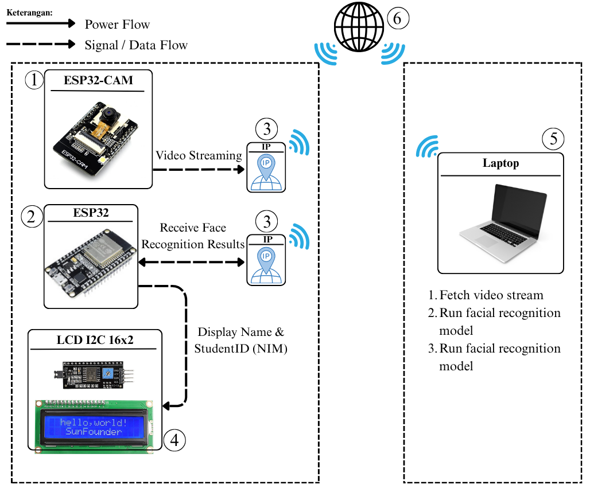
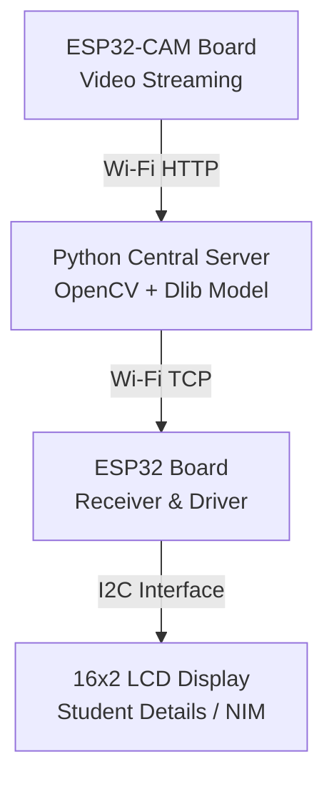

# Face Bridge: ESP32-CAM Face Recognition Attendance System

[](https://www.python.org/)
[](https://www.espressif.com/)
[](LICENSE)

**Face Bridge** is an integrated IoT hardware and software ecosystem designed for automated facial recognition attendance system. The system captures live video streams via an ESP32-CAM module, processes high-accuracy facial embeddings on a central server using Python, logs attendance in structured dynamic CSV records, and sends real-time identification feedback to an ESP32-driven I2C LCD display via TCP Socket communication.

---

## 🏗️ System Architecture

The following diagram illustrates the high-level hardware architecture, communication protocols, and data flow between the IoT edge devices and the central recognition server:

 

<details>
<summary><b>Click to view ASCII / Mermaid representation</b></summary>



---

## 📁 Repository Structure

```text
esp32-face-attendance-system/
├── dataset/              # Raw facial image samples (Ignored by Git)
│   └── .gitkeep
├── feature_db/           # Generated .pickle face encoding files (Ignored by Git)
│   └── .gitkeep
├── proof_images/         # Automated attendance verification snapshots (Ignored by Git)
│   └── .gitkeep
├── docs/                 # System documentation, manuals, and schematics
│   └── .gitkeep
├── firmware/             # Microcontroller C++ sketches (Arduino IDE)
│   ├── esp32_cam_server/
│   │   ├── esp32_cam_server.ino
│   │   ├── camera_pins.h
│   │   ├── app_httpd.cpp
│   │   └── camera_index.h
│   └── esp32_lcd_display/
│       └── esp32_lcd_display.ino
├── .gitignore            # Git exclusion rules for privacy and build binaries
├── face_encoder.py       # Batch feature extraction script
├── main_attendance_app.py# Main recognition engine and schedule validator
├── README.md             # Project documentation
└── requirements.txt      # Python dependencies manifest

```

---

## 🚀 Getting Started

### 1. Prerequisites & Installation

1. **Clone the Repository:**
```bash
git clone [https://github.com/your-username/esp32-face-attendance-system.git](https://github.com/your-username/esp32-face-attendance-system.git)
cd esp32-face-attendance-system

```


2. **Set Up Python Virtual Environment:**
```bash
python -m venv venv
source venv/bin/activate  # On Windows: venv\Scripts\activate

```


3. **Install Dependencies:**
```bash
pip install -r requirements.txt

```


---

### 2. Microcontroller Firmware Setup

1. **ESP32-CAM Server:**
* Open `firmware/esp32_cam_server/esp32_cam_server.ino` in Arduino IDE.
* Update Wi-Fi credentials (`ssid` & `password`).
* Select **AI Thinker ESP32-CAM** board and flash the device.


* Note the allocated IP address from the Serial Monitor (e.g., `http://192.168.1.50/capture`).


2. **ESP32 LCD Display:**
* Open `firmware/esp32_lcd_display/esp32_lcd_display.ino` in Arduino IDE.
* Update Wi-Fi credentials (`ssid` & `password`).
* Select **ESP32 Dev Module** board and flash the device.


* Note the LCD local IP address printed upon startup.


---

### 3. Execution Pipeline

1. **Dataset Preparation & Encoding:**
* Place student training images in `dataset/<Student_Name>/`.
* Run the encoding pipeline:
```bash
python face_encoder.py

```


* Biometric embeddings will be serialized into `feature_db/<Student_Name>.pickle`.


2. **Launch Central Recognition App:**
* Update `ESP32_CAM_URL` and `ESP32_LCD_IP` in `main_attendance_app.py`.
* Execute the application:
```bash
python main_attendance_app.py

```


---

## 📜 Intellectual Property & Copyright (HKI)

This software ecosystem and its hardware implementation logic are protected under official Intellectual Property Rights (Hak Kekayaan Intelektual - HKI):

* **Project Title:** System Engineering of Face Bridge for Attendance Recognition


* **Copyright Holders:**
* Made Agata Purwananda


* Made Guna Dharma Arya Wiwesa


* **Institution:** Department of Electrical Engineering, Faculty of Engineering, Universitas Udayana, Bali, Indonesia.


* **Year of Creation:** 2025


---

## 📄 License

Distributed under the **MIT License**. See `LICENSE` for more information.

```

```